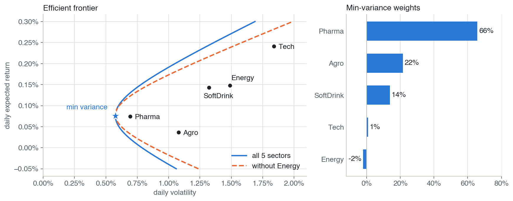
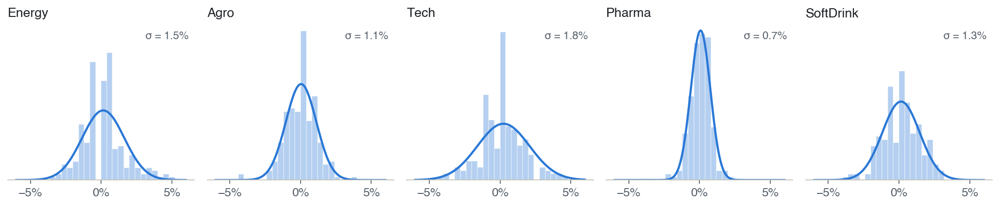
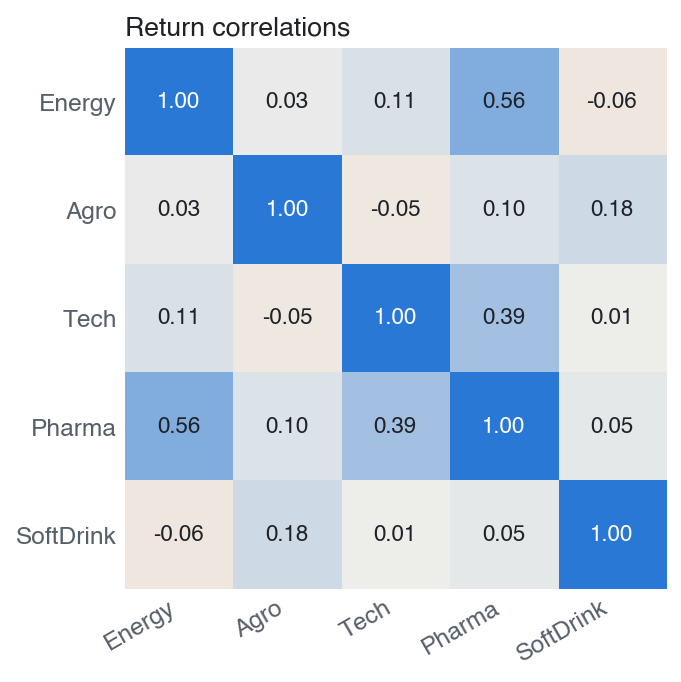
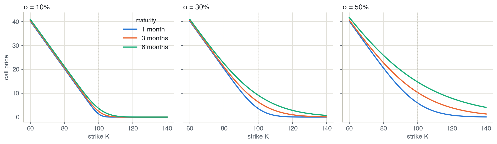
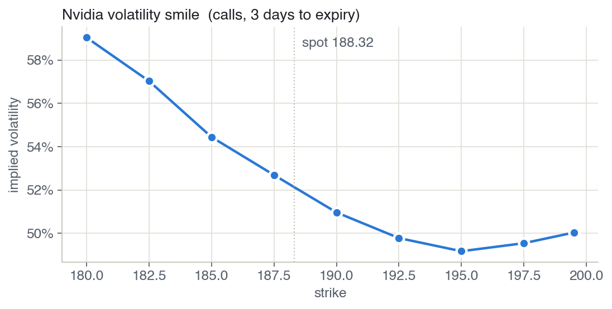

# Markowitz & Black–Scholes

Two classic models of mathematical finance, implemented from scratch in Python. The first finds the lowest-risk mix of five sector stocks. The second prices call options and backs out the market's implied volatility.

## 1 · Portfolio optimization (Markowitz)



The frontier is the lowest volatility you can get for each target return. The minimum-variance portfolio is mostly Pharma (66 %), the calmest sector, with a small short position in Energy. Dropping Energy shifts the frontier to the right, so the same return now costs more risk.

<details>
<summary>Inputs: return distributions and correlations</summary>





</details>

## 2 · Option pricing (Black–Scholes)



Call price vs. strike for S₀ = 100 and r = 3 %. A longer maturity and a higher σ both make the option more valuable.



Implied volatility is the σ that makes Black–Scholes match the market price, solved with Brent's method. If Black–Scholes were exactly right, this curve would be flat.

## Structure

```
src/portfolio.py         returns, covariance, efficient frontier, min-variance portfolio
src/options.py           Black–Scholes call price, implied volatility
src/main.py              PortfolioAnalysis and OptionPricing (interactive plots)
scripts/make_figures.py  the figures above
data/                    daily prices for 5 sectors; Nvidia call quotes
```

## Run

```bash
pip install -r requirements.txt
python src/main.py
python scripts/make_figures.py
```
